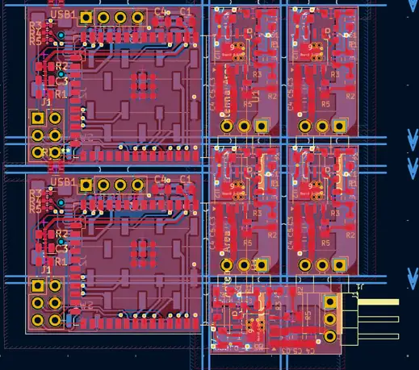

# KiKit Packer

Merge multiple boards into a single file (panel) with minimum area to reduce costs when ordering with your PCB manufacturer.

* Works with rectangular shaped boards
* based on [rectangle-packer](https://github.com/Penlect/rectangle-packer)
* finds maximum density packing by offset and 90° rotation
* applies penalty for rotation (prefer layouts with least rotated area)

## Example Output



Input: 2x MCU head + 5x PSU for [Fugu2](https://github.com/fl4p/Fugu2) solar charger. Please ignore
the [vcuts](https://github.com/fl4p/kikit-packer/issues/1) here.

## Setup

You need to have KiCad with [KiKit](https://yaqwsx.github.io/KiKit/latest/installation/intro/) plugin installed.

Clone this repository into a folder (e.g. `~/dev/`)

```
git clone https://github.com/fl4p/kikit-packer
cd kikit-packer
```

Then install the requirements, according to one of the following sections for macOS, Linux and Windows:


### Install dependencies (macOS)

Create a new virtual environment based on the KiCad one and install requirements:

```
PYTHON=/Applications/KiCad/KiCad.app/Contents/Frameworks/Python.framework/Versions/Current/bin/python3
${PYTHON} -m venv --system-site-packages venv-ki
./venv-ki/bin/pip3 install -r requirements.txt
```

### Install dependencies (Linux)

Test if you can import `pcbwnew`:

```
python3 -c "import pcbnew; print(pcbnew._pcbnew)"
```

Create a new virtual environment:

```
PYTHON=python3
${PYTHON} -m venv --system-site-packages venv
./venv/bin/pip3 install -r requirements.txt
```

### Install dependencies (Windows)

```
"C:\Program Files\KiCad\8.0\bin\python.exe" -m pip install -r requirements.txt
```

This is for KiCad 8.0, update version number if in the path if needed.


## How to use
Create a yaml file listing all your boards you want to combine and how many copies you need:

```yaml
max_width: 300mm     # optional panel size limits
max_height: 200mm
boards:
  B1:                # no filename: extracted from the main board file via its kikit:Board annotation B1
    qty: 1
    margin: 2mm      # default = 1mm
  DebugProbe:        # with filename: the name is only a label, the whole board in the file is used
    qty: 2
    filename: debug-probe/debug-probe.kicad_pcb
  Sensor:
    filename: sensor/sensor.kicad_pcb
    qty: 4
```

Per-board keys:

- `qty`: number of copies (default 1).
- `filename`: board file to use. Without it, the board name is the reference of a
  [`kikit:Board` annotation](https://yaqwsx.github.io/KiKit/latest/multiboard/) in the main board file.
- `margin`: space reserved around each copy in the packing (default `1mm`). It does not enlarge the area
  extracted from the source board. Parts that stick out of the outline (edge connectors, pads, tracks,
  graphics, but not zones or footprint text) are packed as part of the board, and the margin is added
  around them. This keeps boards apart, but KiKit places a frame or rails (`--framing`) from the board
  outlines plus the framing `vspace`/`hspace` (and `slotwidth` for `tightframe`), so parts sticking out
  on the outside of the panel can reach into the framing. The packer then prints a warning with the
  board, the side and the framing setting that clears it. It does not change your framing settings itself.
- `tolerance`: how far items may stick out of the board outline and still be included, like KiKit's
  `source.tolerance` (default `1mm`).
  In a multi-board file, keep the gap between annotated boards larger than `tolerance`: otherwise a
  neighbour's footprints and tracks near the gap are copied too (the packer prints a warning).
- Lengths must not be negative, and `max_width`/`max_height` must be greater than zero.
- `rotate`: turn the board before packing, counter-clockwise like KiCad (default `0deg`). Any angle works: the
  packer reserves the bounding box of the rotated board. Giving `rotate` fixes the board at that angle.
- `allow_rotation`: let the packer turn the board by another 90° when that packs denser. Default `true`, but
  `false` for boards that set `rotate`; set it to `true` explicitly to make `rotate` only the preferred angle.
  Among equally dense layouts the packer keeps boards at their `rotate` angle.

Lengths take KiKit units (`2mm`, `0.5in`, ...). A bare number is read as millimetres.
Angles take KiKit units (`90deg`, `0.5rad`). A bare number is read as degrees.

The older list format (`- board: path.kicad_pcb`, `margin_mm: 2`) and the `input:` layout parameter
still work. In the list format `rotate` only sets the preferred angle (the packer may still turn the board
by 90°), because that format used to ignore it; use `allow_rotation: false` there to fix the angle.

Here we name this file `probe-and-4sensors.yaml`.
File names in the `.yaml` file are relative to the folder where the `.yaml` is stored.

Then run kikit from shell:

```shell
kikit panelize \
  --layout 'plugin; code: kikit-packer/kikit-packer.py.Plugin; arg:probe-and-4sensors.yaml' \
    --tabs 'fixed; hwidth: 2mm; vwidth: 2mm' \
    --cuts 'mousebites' \
    --post 'millradius: 1mm' \
  main_board.kicad_pcb combined.kicad_pcb
```

The main board command line argument (`main_board.kicad_pcb` here) and output file (`combined.kicad_pcb`) are relative to
the current working directory. The output board will have the same board setup (DRC etc.) as the main board file.

## V-cuts

A V-cut is a straight score line across the whole panel, so a free packing usually cuts boards in
half ([#1](https://github.com/fl4p/kikit-packer/issues/1)). Mouse bites have no such restriction
and are the recommended cut type.

With `--cuts vcuts` the packer only accepts layouts in which no V-cut line runs inside a board
(beyond 1 µm) or under another board's parts that stick out of its outline (a board's own cut under
its own edge connector is fine). It tries the free packing and a single row or column of boards, each with the
rotations the boards allow (`rotate` and `allow_rotation` apply here too), and keeps the densest
layout that passes. If none passes, it stops with an error. A top-level `pack:` key in the `.yaml`
file forces one packer: `free`, `row`, `column` or `vcut` (all three).

The check predicts KiKit's cuts: one on every board edge that faces another board or the frame
(`railstb`: top and bottom edges, `railslr`: left and right edges, `frame`/`tightframe`: all edges),
moved by the `offset` of `--cuts`. A positive offset moves every cut that far into its own board, so
the packer prints a warning for it. V-cuts need board edges at multiples of 90°, so other `rotate`
angles are refused in V-cut mode.

With a frame or rails KiKit does not tab every edge that faces the frame. If no layout passes the
check, the packer falls back to one that only assumes the outermost edges are tabbed, says so, and
relies on KiKit's own V-cut check. It also names the framings (no framing, `railstb`, `railslr`)
under which one of the same layouts would pass the check. The fallback only takes layouts where any cut KiKit might still
make inside a board is more than 1 mm deep, because KiKit ignores shallower ones and cuts under
protruding parts. KiKit does not
stop on a bad cut: it still writes the panel, with the offending cuts drawn on the Margin layer and
listed as errors, and exits with code 1. Check the exit code.
